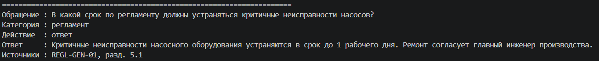

Занятие 9. Классификация обращений.

1. Какое обращение из пяти демо могло бы уйти не в ту ветку и почему?

--- Я думаю, что 2-ое обращение, т.к. в нем речь идет и по регламенту, и в тоже время о неисправности оборудования (инциденте). Классификатор может ошибочно присвоить "инцидент", хотя человек спрашивает про "регламент"

2. Чем ветка "не определено" отличается от ветки "в базе нет ответа"?

--- "Не определено" - отказ классификатора: ИИ не смог определить к какой категории относится обращение, поиска не было.
"В базе нет ответа" - ИИ определил категорию, провел поиск, но не нашел подходящих источников.